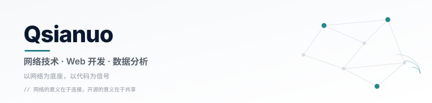
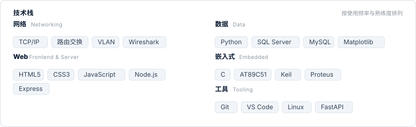
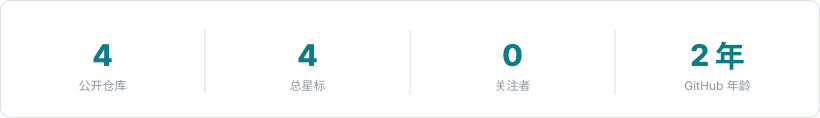
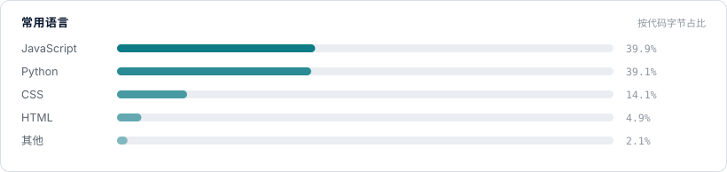
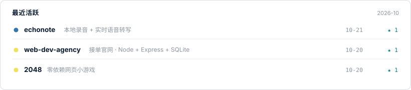

<!--
  ═══════════════════════════════════════════════════════════════
  Qsianuo · GitHub Profile
  定位：网络技术 · Web 开发 · 数据分析
  说明：页面内所有图片均为仓库内自托管 SVG（assets/），
        通过 <picture> 适配浅色 / 深色主题，不依赖任何第三方图床。
  ═══════════════════════════════════════════════════════════════
-->

<div align="center">
  <picture>
    <source media="(prefers-color-scheme: dark)" srcset="assets/banner-dark.svg">
    
  </picture>
</div>

<div align="center">
  <sub><b>技术阵地</b></sub>
  <a href="https://x.com/Qiyian_Small">X</a>
  ·
  <a href="https://juejin.cn/user/2046660854168060">掘金</a>
  ·
  <a href="https://dev.to/qsianuo">Dev.to</a>
  ·
  <a href="https://blog.csdn.net/FNXiaohuan">CSDN</a>
  ·
  <a href="https://mp.weixin.qq.com/s?__biz=MzkzODQ3MTM5Mw==&mid=2247483682&idx=1&sn=0479b88e71621cb391e4ba2d69cc2343">微信公众号「七已庵学AI」</a>
</div>

---

## 👋 关于我

```bash
┌─[qsianuo@netlab]─[~]
└─╼ $ whoami
    Qsianuo · 网络技术 / Web 开发 / 数据分析

└─╼ $ cat /etc/qsianuo.conf
    focus    = 网络协议 · 路由交换 · Web 全栈 · 数据可视化
    learning = 网络工程 · Python 生态 · 嵌入式系统
    exchange = 网络技术交流 · 实验复现 · 项目经验分享
    motto    = 网络的意义在于连接，开源的意义在于共享。
```

- 🌐 以**网络技术**为底层视角，理解系统之间如何连接、通信与协作
- 💻 用 **Web 开发**把想法做成可访问、可交互的产品
- 📊 用**数据分析**从日志、流量与业务数据中提取价值
- ⚙️ 喜欢把网络原理变成可运行、可复现的实验

---

## 🛠 技术栈

<div align="center">
  <picture>
    <source media="(prefers-color-scheme: dark)" srcset="assets/tech-dark.svg">
    
  </picture>
</div>

---

## 🚀 项目

<table>
  <tr>
    <td width="50%" valign="top">
      <h3>🎙 <a href="https://github.com/Qsianuo/echonote">EchoNote · 声记</a></h3>
      <p>本地录音 + 实时语音转文字。<code>faster-whisper</code> 离线推理，<code>FastAPI</code> + <code>WebSocket</code> 流式转写，支持 WAV / TXT / Markdown / SRT 导出，数据全程不出本机。</p>
      <p><sub>⭐ 1 · <code>Python</code> <code>Whisper</code> <code>FastAPI</code> · MIT</sub></p>
    </td>
    <td width="50%" valign="top">
      <h3>🌐 <a href="https://github.com/Qsianuo/web-dev-agency">Web Dev Agency</a></h3>
      <p>商业接单官网。<code>Node.js</code> + <code>Express</code> + <code>SQLite</code>，包含套餐展示、在线下单、会员中心、扫码登录（演示）与管理后台。</p>
      <p><sub>⭐ 1 · <code>Node.js</code> <code>Express</code> <code>SQLite</code></sub></p>
    </td>
  </tr>
  <tr>
    <td width="50%" valign="top">
      <h3>🎮 <a href="https://github.com/Qsianuo/2048">2048</a></h3>
      <p>零依赖、无构建、打开即玩的网页小游戏。原生 HTML / CSS / JavaScript，支持键盘与触屏，含本地最高分记录。</p>
      <p><sub>⭐ 1 · <code>JavaScript</code> <code>Vanilla JS</code></sub></p>
    </td>
    <td width="50%" valign="top">
      <h3>📦 更多项目</h3>
      <p>课程设计、网络实验、数据可视化与小工具陆续整理开源中。</p>
      <p><sub><a href="https://github.com/Qsianuo?tab=repositories">查看全部仓库 →</a></sub></p>
    </td>
  </tr>
</table>

---

## 📊 GitHub 数据

<div align="center">
  <picture>
    <source media="(prefers-color-scheme: dark)" srcset="assets/stats-dark.svg">
    
  </picture>
  <picture>
    <source media="(prefers-color-scheme: dark)" srcset="assets/langs-dark.svg">
    
  </picture>
  <picture>
    <source media="(prefers-color-scheme: dark)" srcset="assets/activity-dark.svg">
    
  </picture>
</div>

---

## 📡 技术交流

> 欢迎通过 **Issues** 或 **Discussions** 交流网络技术、实验思路与项目经验。
> 交流原则：**开放 · 可复现 · 延迟最低**。

- 📡 一起讨论：网络协议、路由交换、排障方法
- 🧰 一起复现：网络实验、课程设计、小型项目
- 📝 一起总结：实验笔记、踩坑记录、优化经验

<div align="center">
  <a href="https://github.com/Qsianuo"><b>@Qsianuo</b></a>
  ·
  <a href="mailto:185434842+Qsianuo@users.noreply.github.com">Email</a>
  ·
  <a href="https://mp.weixin.qq.com/s?__biz=MzkzODQ3MTM5Mw==&mid=2247483682&idx=1&sn=0479b88e71621cb391e4ba2d69cc2343">微信公众号</a>
</div>
