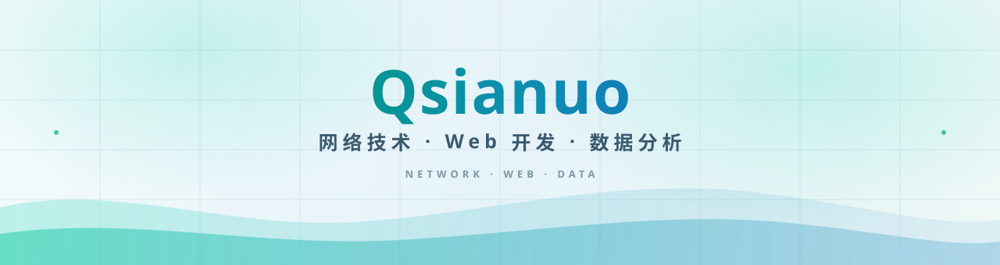

<!--
  ═══════════════════════════════════════════════════════════════════════
  Qsianuo · GitHub Profile
  风格：仿 guojin-yan 的「徽章 + 渐变头图」重型视觉主页
  改造点：
    1. 头图 / 页脚改为仓库内自托管 SVG（assets/），不依赖 vercel 图床
    2. 所有数据徽章为 shields.io 动态取值，Star / 关注者会自己更新
    3. 内容全部换成真实信息（网络技术 · Web 开发 · 数据分析）
  ═══════════════════════════════════════════════════════════════════════
-->

<!-- ══════════ 头图：3 秒看清是谁 ══════════ -->
<div align="center">
  <picture>
    <source media="(prefers-color-scheme: dark)" srcset="assets/hero-dark.svg">
    
  </picture>
</div>

<div align="center">
  
</div>

<!-- ══════════ 数据条：3 秒看清交付力 ══════════ -->
<div align="center">

[](https://github.com/Qsianuo?tab=repositories)
[](https://github.com/Qsianuo?tab=repositories)
[](https://github.com/Qsianuo)
[](https://github.com/Qsianuo)

</div>

---

<!-- ══════════ 联系方式 ══════════ -->
<h2 align="center">🌐 Connect With Me</h2>

<div align="center">

<p>
  <a href="https://github.com/Qsianuo"></a>
  <a href="https://x.com/Qiyian_Small"></a>
  <a href="https://juejin.cn/user/2046660854168060"></a>
  <a href="https://dev.to/qsianuo"></a>
  <a href="https://blog.csdn.net/FNXiaohuan"></a>
</p>

<p>
  <a href="mailto:185434842+Qsianuo@users.noreply.github.com"></a>
  <a href="https://wpa.qq.com/msgrd?v=3&uin=2037915574&site=qq&menu=yes"></a>
  <a href="https://github.com/Qsianuo"></a>
  <a href="https://mp.weixin.qq.com/s?__biz=MzkzODQ3MTM5Mw==&mid=2247483682&idx=1&sn=0479b88e71621cb391e4ba2d69cc2343"></a>
</p>

<sub>QQ <b>2037915574</b> · 微信 <b>hh2037915574</b> —— 加好友请备注「GitHub」</sub>

</div>

---

<!-- ══════════ 技术栈 ══════════ -->
<h2 align="center">🎯 Tech Stack</h2>

<p align="center">
  
  
  
  
  
</p>

<p align="center">
  
  
  
  
  
</p>

<p align="center">
  
  
  
  
  
</p>

<p align="center">
  
  
  
  
</p>

---

<!-- ══════════ 核心项目：横向三栏 ══════════ -->
<h2 align="center">🏆 Core Projects</h2>

<div align="center">

<table>
<tr>

<td width="33%" valign="top">

<h3>
  <a href="https://github.com/Qsianuo/echonote">
    
  </a>
</h3>

<p>
  
  
  
</p>

<p><b>🎤 录音 + 实时语音转文字</b></p>

**✨ Features:**
- 🔒 全程离线，数据不出本机
- ⚡ faster-whisper 本地推理
- 🔌 FastAPI + WebSocket 流式转写
- 📄 导出 WAV / TXT / SRT
- 📜 MIT 协议，开箱即用

<p>
  <a href="https://github.com/Qsianuo/echonote">
    
  </a>
</p>

</td>

<td width="33%" valign="top">

<h3>
  <a href="https://github.com/Qsianuo/web-dev-agency">
    
  </a>
</h3>

<p>
  
  
  
</p>

<p><b>🌐 网站定制开发服务平台</b></p>

**✨ Features:**
- 🧱 Node.js + Express + SQLite
- 💳 套餐展示与在线下单流程
- 👤 会员中心 + 扫码登录（演示）
- 🛠 完整管理后台
- 🚀 零构建，npm start 即跑

<p>
  <a href="https://github.com/Qsianuo/web-dev-agency">
    
  </a>
</p>

</td>

<td width="33%" valign="top">

<h3>
  <a href="https://github.com/Qsianuo/fare-radar">
    
  </a>
</h3>

<p>
  
  
  
</p>

<p><b>✈ 多渠道机票比价工具</b></p>

**✨ Features:**
- 🔍 多渠道比价聚合
- 🖥 CLI + Web + MCP 三形态
- 🧪 PRD → 开发 → 测试 → Issue
- 📦 8 个版本迭代记录
- 📜 零依赖，纯标准库

<p>
  <a href="https://github.com/Qsianuo/fare-radar">
    
  </a>
</p>

</td>

</tr>
</table>

</div>

---

<!-- ══════════ 更多项目：折叠 ══════════ -->
<h2 align="center">📦 More Projects</h2>

<div align="center">

<details>
<summary><b>🎯 Click to Expand (4 More Projects)</b></summary>

<br/>

<table>
<tr>

<td width="50%" valign="top">

<h4>
  <a href="https://github.com/Qsianuo/2048">
    
  </a>
</h4>

<p>
  
  
</p>

<p><b>🎮 打开即玩的 2048</b></p>

**✨ Features:**
- 📜 原生 HTML / CSS / JS，零构建
- ⌨️ 键盘 + 📱 触屏双操作
- 🏆 本地最高分记录
- 🌙 单文件即可部署

<p>
  <a href="https://github.com/Qsianuo/2048">
    
  </a>
</p>

</td>

<td width="50%" valign="top">

<h4>
  <a href="https://github.com/Qsianuo/yolo26-rocm-day1-labs">
    
  </a>
</h4>

<p>
  
  
</p>

<p><b>🎯 ROCm 上的目标检测全流程</b></p>

**✨ Features:**
- 🚀 推理 → 数据质检 → 训练 → mAP 评测
- 🧪 受控 A/B 实验设计
- 🖥 RX 7900 XTX (gfx1100) 实测
- 🌏 中英双语课程文档
- ✅ 6/6 全部跑通验证

<p>
  <a href="https://github.com/Qsianuo/yolo26-rocm-day1-labs">
    
  </a>
</p>

</td>

</tr>
<tr>

<td width="50%" valign="top">

<h4>
  <a href="https://github.com/Qsianuo/first-pr-playbook">
    
  </a>
</h4>

<p>
  
</p>

<p><b>📖 第一次高质量 PR 的完整路径</b></p>

**✨ Features:**
- 🎯 从真实 Issue 出发
- 🤖 AI 辅助定位与调试
- 🧪 测试与 CI 通关要点
- 👀 Code Review 应答技巧
- 🌏 English-first 双语

<p>
  <a href="https://github.com/Qsianuo/first-pr-playbook">
    
  </a>
</p>

</td>

<td width="50%" valign="top">

<h4>
  <a href="https://github.com/Qsianuo/hello-rocm">
    
  </a>
</h4>

<p>
  
</p>

<p><b>🔥 AMD ROCm 环境最小验证</b></p>

**✨ Features:**
- 🧰 驱动 / 运行时自检
- 📊 GPU 拓扑与显存检查
- ⚡ 最小可跑样例
- 📝 踩坑记录

<p>
  <a href="https://github.com/Qsianuo/hello-rocm">
    
  </a>
</p>

</td>

</tr>
</table>

</details>

</div>

---

<!-- ══════════ 交付力 ══════════ -->
<h2 align="center">📊 Delivery Power</h2>

<div align="center">

<h3>💻 Language Distribution</h3>

```text
JavaScript  ████████████████████████████████████████  39.9%
Python      ███████████████████████████████████████   39.1%
CSS         ██████████████                            14.1%
HTML        █████                                      4.9%
Other       ██                                         2.1%
```

<br/>

<h3>🔥 Contribution Overview</h3>

<p>
  
  
  
  
</p>

</div>

---

<!-- ══════════ 社交与博客 ══════════ -->
<h2 align="center">🔥 Social Media & Blogs</h2>

<div align="center">

<table>
<tr>
<td width="25%" align="center">

<h3>📝 掘金</h3>

<a href="https://juejin.cn/user/2046660854168060">
  
</a>

</td>
<td width="25%" align="center">

<h3>📝 CSDN</h3>

<a href="https://blog.csdn.net/FNXiaohuan">
  
</a>

</td>
<td width="25%" align="center">

<h3>🌏 Dev.to</h3>

<a href="https://dev.to/qsianuo">
  
</a>

</td>
<td width="25%" align="center">

<h3>📱 微信公众号</h3>

<a href="https://mp.weixin.qq.com/s?__biz=MzkzODQ3MTM5Mw==&mid=2247483682&idx=1&sn=0479b88e71621cb391e4ba2d69cc2343">
  
</a>

</td>
</tr>
</table>

</div>

---

<!-- ══════════ 贡献图 ══════════ -->
<h2 align="center">📈 Contribution Activity</h2>

<div align="center">

<picture>
  <source media="(prefers-color-scheme: dark)" srcset="https://raw.githubusercontent.com/Qsianuo/Qsianuo/output/github-contribution-grid-snake-dark.svg"/>
  <source media="(prefers-color-scheme: light)" srcset="https://raw.githubusercontent.com/Qsianuo/Qsianuo/output/github-contribution-grid-snake.svg"/>
  
</picture>

<p><i>🐍 Auto-generated by GitHub Actions</i></p>

</div>

---

<!-- ══════════ 页脚 ══════════ -->
<div align="center">

<h3>🔗 Quick Links</h3>

<p>
  <a href="https://github.com/Qsianuo"></a>
  <a href="https://juejin.cn/user/2046660854168060"></a>
  <a href="https://dev.to/qsianuo"></a>
  <a href="https://blog.csdn.net/FNXiaohuan"></a>
</p>

<p>
  <a href="mailto:185434842+Qsianuo@users.noreply.github.com"></a>
  <a href="https://wpa.qq.com/msgrd?v=3&uin=2037915574&site=qq&menu=yes"></a>
  <a href="https://github.com/Qsianuo"></a>
</p>

<br/>

<picture>
  <source media="(prefers-color-scheme: dark)" srcset="assets/footer-dark.svg">
  
</picture>

</div>
